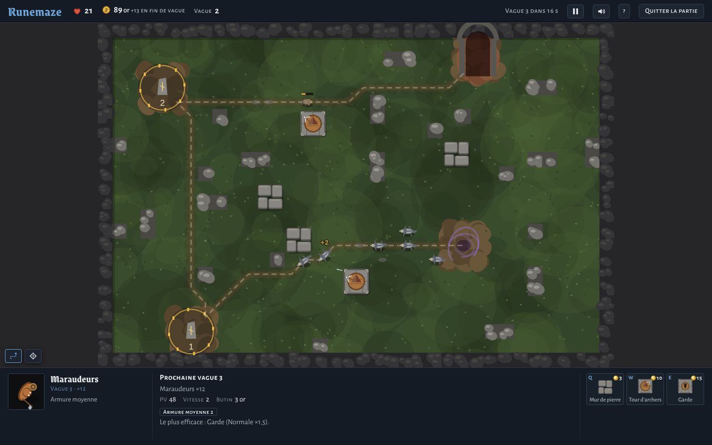
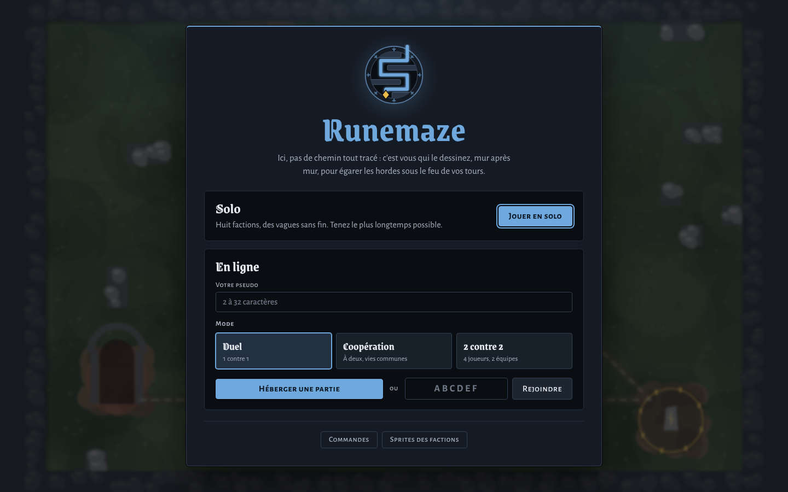
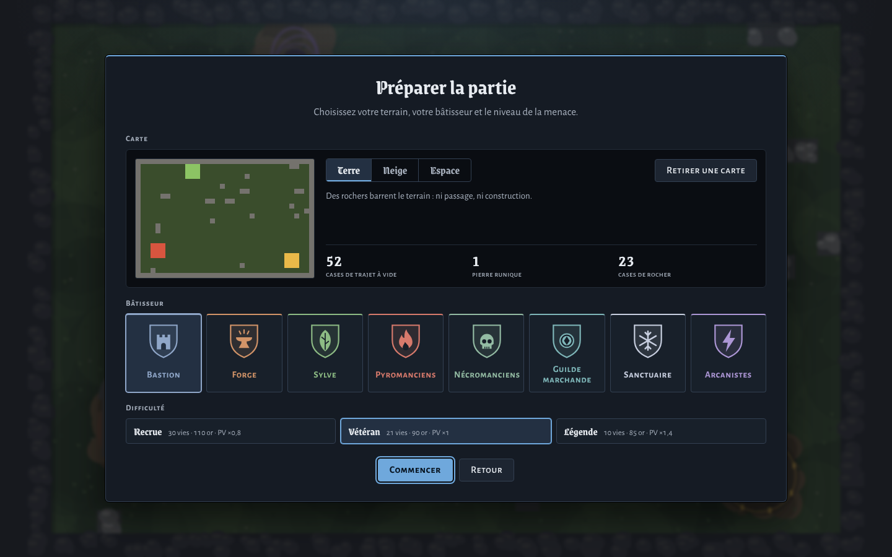

# Runemaze

Runemaze is a *mazing* tower defense in the spirit of Warcraft III custom maps
(Wintermaul, Element TD): there is no fixed path, you draw the maze yourself with your
towers. TypeScript, Canvas 2D, and a Node server (`ws`) that referees each game.

The game itself is in French.

## Preview



| Home screen | Game setup |
|---|---|
|  |  |

## Running

The game is played online: every game is run by a server that referees it.

```bash
npm install
npm run build && npm run server   # build, then game server (http://localhost:8080)
npm test                          # simulation tests
npm run build:artifact            # variant without the <html> wrapper, for a hosted page
```

In development, run two servers side by side: `npm run server` (referee + WebSocket) and
`npm run dev` (Vite, hot reload). The game can no longer be played offline.

## Rules

- Ground creeps leave the portal, **must touch the runestone**, then head for the gate.
  The field is crossed twice.
- 2×2 towers placed freely. A build that would close the path (for the full route or for
  a creep already on its way) is refused.
- **3-gold walls** to lengthen the route, upgradable into any base tower for the price
  difference.
- **Attack / armor table** à la Warcraft III (Normal, Pierce, Siege, Magic, Chaos against
  Unarmored, Light, Medium, Heavy, Fortified, Hero), and reduction by armor value
  `0.06·a / (1 + 0.06·a)`.
- Flyers (ignore the maze), magic immunity, regeneration, three bosses.
- 50% refund of the gold invested, at any time: selling costs half of the stake, so
  *juggling* (selling and rebuilding to divert the flow) no longer pays.
- End-of-wave bounty, 4% interest with a cap.
- Endless waves.

Controls: `Q W E A` build, click to place (right click / `Esc` to cancel),
`P` pause, `M` sound, `L` route, `H` help.
On a tower: `Q W E` upgrade, `A` targeting, `D` sell. On touch screens: first tap to
preview, second tap on the same spot to build.

## Architecture

Clean architecture in four layers; the direction of dependencies is checked by
`tests/architecture.test.ts`.

```
src/
  domain/          ← game core, no dependencies (no DOM, no other layer)
    model/         World (full state + step()), Grid (terrain, occupancy), types
    rules/         Damage (attack/armor table), FlowField (8-direction Dijkstra
                   per leg), pricing (costs, refunds)
    systems/       waves, movement, combat (+ projectiles, chains), status (poison, slow…)
    catalog/       towers, creeps (+ waves, difficulties), map (ASCII map)
    Rng.ts         mulberry32, seed
  application/     ← player orders, depends on domain
    dispatch.ts    single entry point for commands, replay log
    commands/      build, upgrade, sell, target
    queries/       canBuild (anti-blocking validation), previewRoute
  infrastructure/  ← technical adapters, depends on domain
    render/        Renderer (Canvas 2D), procedural sprites, Effects (particles, texts)
    audio/         Sfx: sounds synthesized with Web Audio, no files
    GameLoop.ts    fixed-step requestAnimationFrame, 1/60 s
  presentation/    Game: input, 4×3 command panel, HUD, screens; describe.ts: texts;
                   ServerLink.ts: WebSocket link to the game server
  server/          HTTP + WebSocket server: serves dist/, forwards orders to the referee
                   (application/online/)
tests/             same tree as src/; architecture, support/
```

The choices that matter:

- **Pure, deterministic simulation.** `World` is only changed by `dispatch(world, command)`
  and `step()`. Same seed + same command log = same game, which a replay test checks.
  This is the foundation for replays, a spectator mode, or *lockstep* multiplayer like
  Warcraft III's. Architecturally, it is a command / event model: commands go in, events
  (`kill`, `hit`, `leak`, `waveStart`…) come out and feed rendering, sound and UI without
  the simulation knowing about them.
- **Flow fields rather than A\* per creep.** One Dijkstra pass per leg gives every cell
  its distance to the target and the next cell to step to. The cost does not depend on
  the number of creeps, and recomputing after each build is instant. The same pass
  validates that a build does not close the path and previews the new route.
- **Everything is data.** Towers, upgrade tree, creeps, waves and map are plain objects;
  adding a tower or a map does not touch the engine.
- **Swappable rendering.** `Renderer` only reads `World`. Moving to PixiJS or WebGL would
  touch neither the simulation nor the tests.

## Ideas

- Multi-lane multiplayer (determinism is already there: exchanging commands is enough).
- Map editor: the map is an array of strings.
- Recording and replaying games from `world.log`.
- PixiJS rendering for thousands of particles, hand-drawn sprites.

## Spirit of the project

Runemaze is a just-for-fun project, made to play with friends, and entirely
*vibe coded*. It does not try to follow industrial practices: the goal is to deliver
value fast, meaning being able to play, while avoiding the complexity of production code
(no CI, deployment, monitoring or compatibility to maintain). The architecture and tests
only exist to keep the game easy to evolve.
